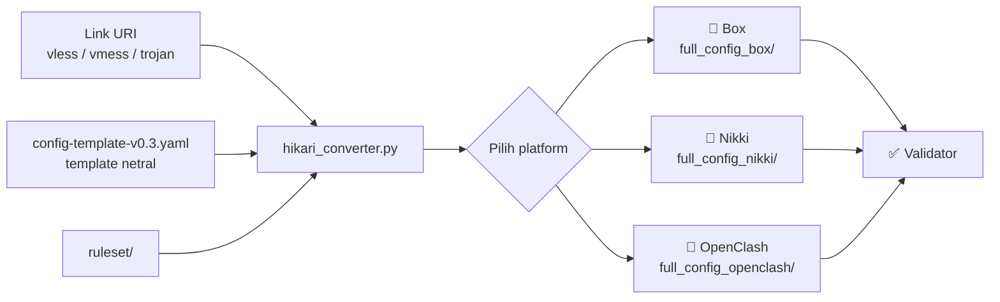

<div align="center">

# 🌸 HIKARI SUBCLASH

**Toolkit CLI offline untuk convert & generate config Mihomo (Clash Meta)**
satu template → siap pakai di **Box for Root**, **Nikki**, dan **OpenClash**


</div>

---

## 📖 Daftar Isi

- [Kenapa Hikari?](#-kenapa-hikari)
- [Fitur](#-fitur)
- [Cara Kerja](#-cara-kerja)
- [Instalasi](#-instalasi)
- [Struktur Folder](#-struktur-folder)
- [Cara Pakai](#-cara-pakai)
- [Memasang Hasil ke Perangkat](#-memasang-hasil-ke-perangkat)
- [Perbedaan Output per Platform](#-perbedaan-output-per-platform)
- [Isi Template & Group](#-isi-template--group)
- [Ruleset](#-ruleset)
- [Tips & Trik](#-tips--trik)
- [Troubleshooting](#-troubleshooting)
- [FAQ](#-faq)
- [Roadmap](#-roadmap)
- [Disclaimer](#%EF%B8%8F-disclaimer)

---

## 💡 Kenapa Hikari?

Ngatur config Mihomo di tiga platform itu ribet: port beda, path beda, fitur Android (tun, per-app) bentrok dengan OpenWrt, dan hampir semua tool convert butuh internet. Hikari menyelesaikannya dengan:

- **Satu template netral**, bagian yang beda per platform disuntik otomatis.
- **Offline**: tempel link, jadi config. Tanpa subscription converter online.
- **Validator bawaan**: salah referensi group/rule/provider ketahuan *sebelum* config dipasang.

---

## ✨ Fitur

| | |
|---|---|
| 🔄 **Dua arah** | `vless://` `vmess://` `trojan://` ⇄ YAML Clash. Support WS, gRPC, HTTPUpgrade, H2, TLS, **Reality + flow/fingerprint**, ALPN, `allowInsecure`, IPv6 |
| 🎯 **Preview & edit** | Tabel preview, hapus/tambah node, baris gagal ditampilkan **lengkap dengan alasannya** |
| 🧬 **Anti duplikat** | Nama node kembar otomatis jadi `Nama (2)`, `Nama (3)` |
| 🛠️ **Auto-patch platform** | Port, DNS listen, `tun`, path provider, controller, rule WIFI disesuaikan per platform |
| ✅ **Validator** | Cek group/rule/provider, file provider, port bentrok, controller tanpa secret, DNS rawan, dll |
| 🔌 **Mode Offline** | Ubah semua rule-provider `http` → `file` (tanpa update GitHub) |
| ➕ **Replace / Append** | Timpa atau tambah node ke provider yang sudah ada |
| 🌐 **Menu DNS** | Cloudflare+Google, Quad9 Unsecured, NextDNS, AdGuard, atau custom — format & komentar template dijaga |
| 🧰 **Tools ruleset** | Padatkan `port-games.yaml` (23.366 baris → 87 range, perilaku identik) |
| 🛡️ **Aman** | Auto-backup `.bak`, input divalidasi, `PermissionError` ditangani, secret dashboard otomatis |

---

## 🧠 Cara Kerja



Pipeline: `template → parse YAML → patch per platform → validasi → tulis config.yaml`.

---

## 📦 Instalasi

**Termux (Android):**

```bash
pkg update && pkg install python git -y
pip install pyyaml
termux-setup-storage          # izinkan akses penyimpanan
```

**Linux / OpenWrt / PC:**

```bash
pip install pyyaml            # butuh Python 3.8+
```

**Ambil project:**

```bash
git clone https://github.com/nexterade/crispy-funicular.git hikari_sub
cd hikari_sub
```

> Di Termux, taruh foldernya di `/storage/emulated/0/Documents/hikari_sub` — **jangan** di `~` biar tidak kena `PermissionError` dan gampang diakses file manager.

---

## 📂 Struktur Folder

```text
hikari_sub/
├── hikari_converter.py          # Script utama
├── config-template-v0.3.yaml    # Template master (netral platform)
├── template.yaml                # (otomatis) salinan kerja, dibuat saat kamu edit lewat menu
├── ruleset/                     # Ruleset (WAJIB): *.yaml & *.mrs
├── archive/                     # Template lama v0.1/v0.2 + port-games versi penuh
├── AUDIT.md                     # Perbandingan template, temuan audit, saran
└── Hasil/                       # (otomatis) hasil generate
    ├── full_config_box/
    ├── full_config_nikki/
    └── full_config_openclash/
```

Template yang dipakai: **`template.yaml`** bila ada, kalau tidak **`config-template-v*.yaml` terbaru**. Edit lewat menu selalu mengubah `template.yaml`; template master tidak pernah disentuh.

---

## 🚀 Cara Pakai

```bash
cd /storage/emulated/0/Documents/hikari_sub
python hikari_converter.py
```

### Menu utama

```text
[1] Convert                 ← link ⇄ Clash YAML
[2] Edit Configuration      ← port & secret, ganti template, DNS
[3] Check Status            ← template, provider, config yang sudah jadi
[4] Validasi / Audit Config ← cek template untuk ketiga platform
[5] Tools Ruleset           ← padatkan port-games.yaml
[6] Exit
```

### Alur Convert (URI ➜ Clash)

1. **Paste** link (`vless://` / `vmess://` / `trojan://`), satu per baris. Enter 2× untuk selesai.
2. **Preview**: lihat daftar node. Aksi: `[T]` tambah · `[H]` hapus (mis. `1,3`) · `[L]` lanjut · `[B]` batal.
   Baris yang gagal ditampilkan beserta alasannya (UUID kosong, transport belum didukung, dll).
3. **Pilih platform**: `B` Box · `N` Nikki · `O` OpenClash.
4. **Pilih provider**: `active.yaml` atau `trial.yaml`. Jika sudah berisi node, pilih **Ganti** atau **Tambahkan**.
5. **Mode rule-provider**: ikuti template (auto-update GitHub) atau **Offline** (file lokal saja).
6. Selesai. Script menampilkan lokasi hasil, hasil validasi, dan **secret dashboard**.

### Convert Clash ➜ URI

Menu `1 → 2`: paste YAML, atau pilih file provider hasil generate. Hasil bisa disimpan ke `Hasil/URI_<tanggal>.txt`.

### Edit Configuration

- **Port & Secret**: ketik `acak` pada Secret untuk generate otomatis. Port divalidasi 1–65535.
- **Ganti Template**: pilih dari `config-template-v*.yaml` yang ada, atau path file sendiri (divalidasi sebelum dipakai).
- **DNS**: pilih preset atau custom (lihat [Tips DNS](#-tips--trik)).

---

## 📲 Memasang Hasil ke Perangkat

Semua hasil ada di folder `Hasil/`.

### 📱 Box for Root → `Hasil/full_config_box/`

Salin **semua isi folder** ke:

```text
/data/adb/box/clash/
```

### 🐧 Nikki → `Hasil/full_config_nikki/`

| Salin | Ke |
|---|---|
| `config.yaml` | `/etc/nikki/profiles/` |
| folder `proxy/` dan `ruleset/` | `/etc/nikki/run/` |

*Jangan dibalik — Nikki memisahkan profile dan file yang berjalan.*

### 🐧 OpenClash → `Hasil/full_config_openclash/`

| Salin | Ke |
|---|---|
| `config.yaml` | `/etc/openclash/config/` |
| folder `proxy_provider/` dan `rule_provider/` | `/etc/openclash/` |

Pindahkan file ke OpenWrt pakai SFTP/WinSCP/scp, atau file manager yang punya akses root.

> ⚠️ **Nikki & OpenClash** umumnya menimpa port, DNS, TUN, controller, dan secret dari pengaturan LuCI-nya sendiri. Kalau dashboard minta secret, pakai yang diset di LuCI.

---

## 🔀 Perbedaan Output per Platform

| | 📱 Box | 🐧 Nikki | 🐧 OpenClash |
|---|---|---|---|
| Port | 7890 / 7891 / 7892 / **9797** / **9898** | dari template | dari template |
| DNS listen | **1053** | dari template | dari template |
| Blok `tun` | ada (off, dikelola Box) | dibuang | dibuang |
| `find-process-mode` | `always` (lihat app per koneksi) | – | – |
| Group & rule **WIFI** | ada | **dibuang** | **dibuang** |
| Path provider | `./proxy`, `./ruleset` | `/etc/nikki/run/proxy`, `/etc/nikki/run/ruleset` | `./proxy_provider`, `./rule_provider` |
| `external-controller` | `127.0.0.1:9090` | `0.0.0.0:9090` | `0.0.0.0:9090` |

**Kenapa WIFI dibuang di OpenWrt?** Rule itu mencocokkan IP sumber `192.168.0.0/16`. Di router, *semua* client LAN punya IP itu, jadi seluruh trafik akan jatuh ke group WIFI (default Direct) dan proxy tidak pernah jalan.

---

## 🧩 Isi Template & Group

Urutan rule = prioritas (atas ke bawah):

| # | Rule-set | Group tujuan | Fungsi |
|---|---|---|---|
| 1 | `Direct` | DIRECT | LAN, `.local`, `.lan` |
| 2 | `DnsHijack` | 🐬 Hijack | DNS port 53 |
| 3 | `Reject` | ✂️ Reject | DoT (853) & QUIC (UDP 443) |
| 4 | `WifiClients` | 🪺 WIFI | Client WiFi/hotspot *(Box saja)* |
| 5 | `Blocker` | 💤 BLOCKER | Blokir iklan |
| 6 | `Plusplus` | 💕 PLUSPLUS | Unblock konten +18 |
| 7 | `Portgames` | 🪼 GAMING | Port game (default Direct) |
| 8 | `Inject` | 🧩 Inject | Google, Bing, DuckDuckGo |
| 9 | `SmartMode` | 🌳 SMART ROUTING | AI, game launcher, sosmed, ISP |
| – | `MATCH` | 🧩 Inject | Sisanya |

Group node: **🧩 Inject** (pusat), **🦈 AUTO MODE** (url-test), **🍋‍🟩 PROXY LIST** (pilih manual). Semua memakai provider `Active` + `Trial`.

---

## 📚 Ruleset

| File | Isi |
|---|---|
| `blocker.mrs` | Daftar iklan (domain, format mrs) |
| `plus18.mrs` | Daftar +18 (domain, format mrs) |
| `smartmode.yaml` | Domain/CIDR untuk SMART ROUTING |
| `inject.yaml` | Domain yang selalu lewat Inject |
| `direct.yaml` / `reject.yaml` / `dns-hijack.yaml` | Aturan dasar |
| `wifi.yaml` | Client WiFi (SRC-IP) |
| `port-games.yaml` | 87 range port game (versi penuh ada di `archive/`) |
| `fakeip-filter.yaml` | Domain yang di-resolve IP asli |
| `skip-sniff.yaml` / `force-sniff.yaml` | Daftar sniffer |

Rule-provider di template bertipe `http` (update tiap 24 jam dari GitHub); file di `ruleset/` dipakai sebagai cache awal. Mau 100% offline? Pilih **Mode Offline** saat generate.

---

## 🎒 Tips & Trik

**🔖 Alias Termux** — cukup ketik `subclash`:

```bash
echo 'alias subclash="cd /storage/emulated/0/Documents/hikari_sub && python hikari_converter.py"' >> ~/.bashrc
source ~/.bashrc
```

**📦 Active vs Trial** — `active.yaml` untuk node harian, `trial.yaml` untuk node yang lagi dicoba. Keduanya otomatis masuk **AUTO MODE** dan **PROXY LIST**.

**➕ Pakai Append** — tambah node baru tanpa menghapus yang lama. Nama otomatis dijaga unik.

**🌐 Tips DNS (penting!)**

- `nameserver` (DoH) lewat proxy → aman dari reset ISP.
- `proxy-server-nameserver` & `direct-nameserver` sengaja **DNS polos** (`8.8.8.8`, `1.1.1.1`). Banyak ISP/modem **me-reset DoH** ke IP publik port 443; kalau itu dipakai untuk resolve domain server proxy, **semua node timeout**.
- Kalau `8.8.8.8` ikut diblok di jaringanmu, ganti ke DNS ISP lewat menu *DNS → Custom* atau edit `template.yaml`.
- Menu DNS tidak menerapkan DoH ke `proxy-server-nameserver` secara default, dan validator akan memperingatkan kalau list itu DoH semua.

**🔌 Mode Offline** — pilih saat generate kalau tidak mau ruleset berubah sendiri, atau GitHub raw sedang lambat/terblokir.

**🧪 Validasi dulu sebelum pasang** — menu `4` mengecek template untuk Box, Nikki, dan OpenClash sekaligus. Opsional, kalau core Mihomo ada di mesinmu:

```bash
mihomo -t -d Hasil/full_config_box -f Hasil/full_config_box/config.yaml
```

**🔐 Secret dashboard** — kalau kolom secret di template kosong, script bikin acak dan menampilkannya setelah generate. Mau tetap? Menu `2 → 1`, ketik `acak` sekali, secret tersimpan di `template.yaml`.

**🪵 Debug** — ubah `log-level: warning` jadi `debug` di `template.yaml`, generate ulang, lalu lihat tab *Logs* di dashboard.

**🧯 Backup** — setiap edit lewat menu membuat `template.yaml.bak`. Template master & `archive/` aman untuk rollback.

**🎮 Rule GAMING** — `port-games.yaml` mencocokkan port TCP+UDP. Kalau ingin hanya UDP, ubah entri jadi `AND,((NETWORK,UDP),(DST-PORT,5000-5221))`.

**🗜️ Padatkan port-games** — menu `5 → 1`. File 395 KB jadi ±2 KB dengan hasil routing identik.

---

## 🔧 Troubleshooting

| Gejala | Penyebab | Solusi |
|---|---|---|
| Semua node *timed out*; log: `dns resolve failed ... connection reset by peer` | DoH ke 8.8.8.8 / 1.1.1.1 :443 di-reset ISP, domain server proxy tidak ter-resolve | `proxy-server-nameserver` pakai DNS polos (default template sekarang). Cek: `nslookup domain-server-mu 8.8.8.8` |
| Di OpenWrt semua trafik Direct | Rule WIFI ikut ke router | Pakai script v2 / template v0.3 (WIFI otomatis dibuang) |
| Node Reality/Vision tidak konek | Parser lama membuang `flow` & `fp` | Script v2 membawa `flow`, `client-fingerprint`, `pbk`, `sid` |
| `PermissionError` | Folder di `~` Termux | Pindah ke `/storage/emulated/0/...` setelah `termux-setup-storage` |
| `PyYAML belum terpasang` | Library belum ada | `pip install pyyaml` |
| Dashboard minta secret | Secret acak / diset LuCI | Lihat ringkasan setelah generate; di Nikki/OpenClash pakai secret dari LuCI |
| Port bentrok / core gagal start | Dua port sama | Menu `4` (Validasi) menunjukkan port ganda |
| Rule-provider gagal download | GitHub raw lambat/terblokir | Mode Offline, atau pakai `proxy:` pada provider |
| `transport 'xhttp' belum didukung` | Transport belum ada di parser | Pakai node dengan ws/grpc/tcp, atau tambahkan manual di YAML |
| Provider kosong bikin error di core tertentu | `trial.yaml` berisi `proxies: []` | Isi minimal 1 node |

---

## ❓ FAQ

**Apa bedanya `template.yaml` dan `config-template-v0.3.yaml`?**
Yang kedua master. `template.yaml` salinan kerja yang dibuat otomatis saat kamu edit lewat menu. Kalau `template.yaml` ada, dialah yang dipakai.

**Komentar di config hasil generate kok hilang?**
Hasil generate adalah dump YAML. Komentar tetap ada di template sumber.

**Bisa dipakai untuk protokol lain (SS, Hysteria2, TUIC)?**
Belum; lihat [Roadmap](#-roadmap). Edit manual di file provider tetap valid.

**Port Box harus sama dengan `settings.ini`?**
Ya. Default 9797 (redir), 9898 (tproxy), dns 1053 mengikuti varian Box yang dipakai di v0.1. Sesuaikan jika Box-mu berbeda.

**Kenapa `skip-cert-verify` selalu `true`?**
Kebanyakan node memakai bug-host/SNI custom sehingga sertifikat tidak cocok. Kalau link mengandung `allowInsecure=0`, nilainya dihormati.

**Mau tahu apa saja yang diubah dari v0.1/v0.2?**
Lihat [`AUDIT.md`](AUDIT.md): perbandingan, daftar temuan, dan koreksi.

---

## 🗺️ Roadmap

- [ ] Uji otomatis dengan core asli (`mihomo -t`) di CI
- [ ] Overlay platform sebagai file (`platforms/*.yaml`), bukan di dalam kode
- [ ] Protokol: `ss://`, `hy2://`, TUIC, `xhttp`
- [ ] Mode non-interaktif (`--platform nikki --input nodes.txt --offline`)
- [ ] Impor subscription URL + filter/rename node + group per negara
- [ ] Mirror CDN untuk rule-provider
- [ ] Rule GAMING khusus UDP & dipecah per game

Detail dan alasannya ada di bagian *Saran Pengembangan* pada [`AUDIT.md`](AUDIT.md).

---

## ⚠️ Disclaimer

Proyek ini dibuat untuk mempermudah pengelolaan konfigurasi pribadi. Pastikan penggunaanmu mematuhi hukum dan peraturan yang berlaku di wilayahmu terkait jaringan proxy/VPN. Penulis tidak bertanggung jawab atas penyalahgunaan.

*Don't be stupid, use it wisely.* 🫰

<div align="center">

Made with 🌸 for Box · Nikki · OpenClash

</div>
